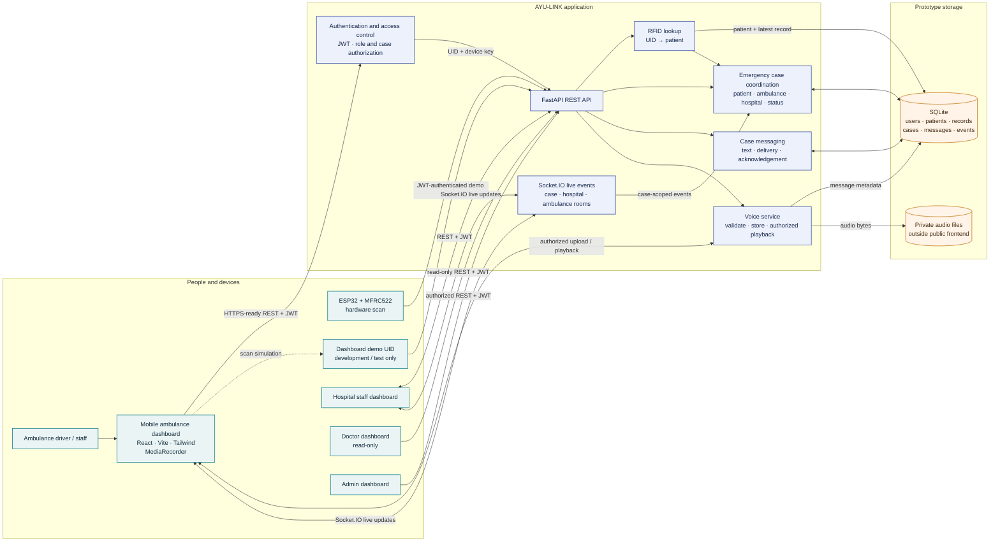
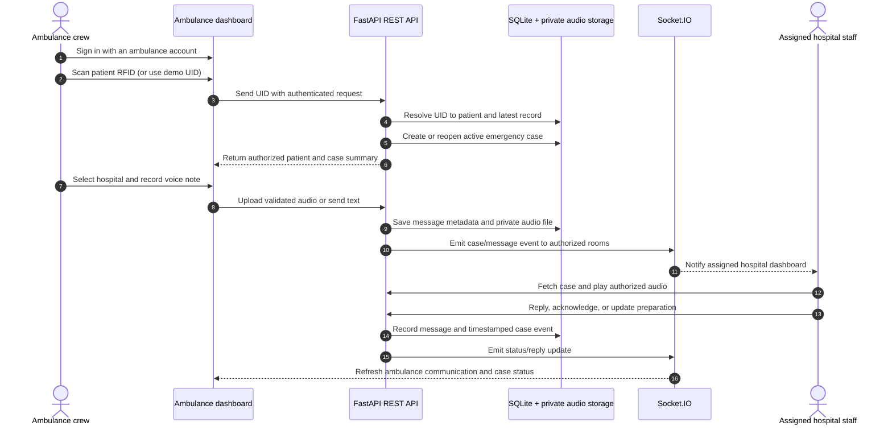

# AYU-LINK prototype architecture

AYU-LINK is a presentation prototype for coordinating an ambulance-to-hospital
emergency handoff. This diagram reflects the current implementation: React/Vite
role dashboards, a FastAPI REST API, Socket.IO live events, SQLite-backed
records, and audio files stored outside the frontend's public directory.

## System architecture

## Emergency handoff sequence

## Access and prototype boundaries

- Ambulance drivers and authorized ambulance staff use the ambulance dashboard
  and case communication tools.
- Hospital staff can respond to cases assigned to their hospital. Doctors have
  read-only case access; admins use their separate authorized dashboard.
- The development/test RFID simulator is not the hardware interface. The
  ESP32-compatible scan endpoint authenticates with a device key.
- RFID cards carry a UID only; patient details are looked up on the backend.
- Voice recording requires browser microphone permission. Audio is validated
  and served only through an authorized case request.
- This is a presentation prototype, not a clinically validated or
  production-ready patient-care system.

## Presentation slide

The one-page, 16:9 workflow graphic is available as
[ayu-link-emergency-flow.svg](./ayu-link-emergency-flow.svg). SVG stays sharp
when resized and can be inserted directly into slides or exported to PNG.